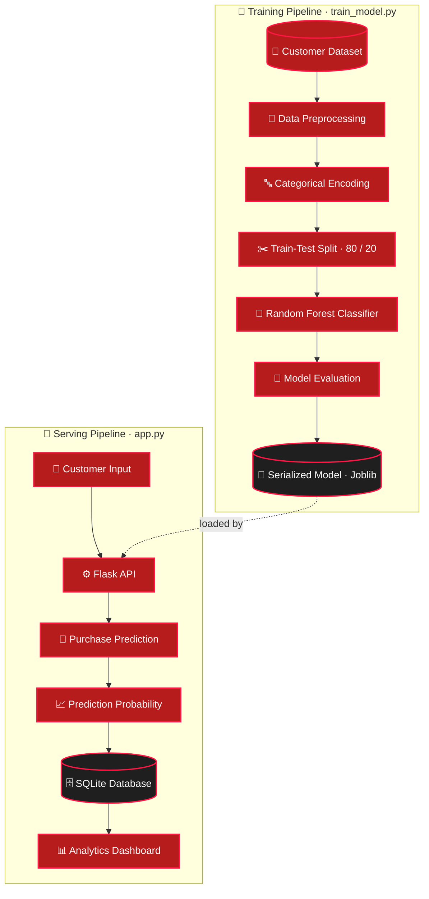

<!-- ===================== HEADER ===================== -->
<div align="center">


<a href="https://predictai-eq5w.onrender.com">
  
</a>

<br/>

<a href="https://predictai-eq5w.onrender.com">
  
</a>
<a href="https://github.com/PritwishSaha/PredictAI">
  
</a>

<br/><br/>


<br/>


</div>


## 📌 Table of Contents

| | | |
|---|---|---|
| [📖 Overview](#-overview) | [🤖 ML Workflow](#-machine-learning-workflow) | [🔌 API Endpoints](#-api-endpoints) |
| [✨ Key Features](#-key-features) | [📊 Input Features](#-input-features) | [☁️ Deployment](#️-deployment) |
| [🛠️ Tech Stack](#️-technology-stack) | [📁 Project Structure](#-project-structure) | [🗄️ Database](#️-database) |
| [⚙️ Installation](#️-installation-and-setup) | [🚀 Run the App](#-run-the-application) | [⚠️ Limitations](#️-limitations) |
| [🔮 Roadmap](#-roadmap) | [👨‍💻 Author](#-author) | |

---

## 📖 Overview

**PredictAI** is a machine learning-powered web application that predicts whether a customer is likely to purchase a product, based on **demographics, purchasing behavior, website activity, and loyalty program participation**.

A **Random Forest Classifier** generates the prediction and a probability score, while the app adds interactive analytics, prediction history, and batch predictions through CSV upload.

> 💡 **Why this project?** It shows how machine learning, backend development, frontend development, and database management come together in one practical application.

<div align="center">

| 🎯 Predict | 📈 Score | 📦 Batch | 🕘 Track | 📤 Export |
|:---:|:---:|:---:|:---:|:---:|
| Will the customer buy? | Purchase probability | Many customers via CSV | Full prediction history | Download your records |

</div>

---

## ✨ Key Features

<table>
<tr>
<td width="50%" valign="top">

### 🎯 Individual Prediction
- Enter customer details in an interactive form
- Get the predicted result instantly
- See the model's purchase probability

</td>
<td width="50%" valign="top">

### 📦 Batch Prediction
- Upload customer records as a CSV file
- Process many customers in one operation
- View successful and failed records
- Get purchase / non-purchase statistics

</td>
</tr>
<tr>
<td width="50%" valign="top">

### 📊 Analytics Dashboard
- Overall prediction statistics
- Purchase vs. non-purchase breakdown
- Trends and summary metrics
- Customer prediction activity monitoring

</td>
<td width="50%" valign="top">

### 🕘 Prediction History
- Records saved automatically in SQLite
- Browse previous predictions
- Retrieve a single prediction by ID
- Export the full history

</td>
</tr>
<tr>
<td width="50%" valign="top">

### 🔌 REST API
- Flask-powered backend
- Dedicated prediction endpoints
- Health monitoring endpoint
- Analytics and history endpoints

</td>
<td width="50%" valign="top">

### 🎨 Responsive UI
- Modern red-and-white theme
- Responsive dashboard layout
- Interactive frontend components
- CSS animations and JavaScript interactions

</td>
</tr>
</table>

<!--
📸 SCREENSHOTS (optional)
Add images to static/images/ and uncomment the block below:

## 📸 Screenshots
<div align="center">
  
  
</div>
-->

---

## 🛠️ Technology Stack

| Category | Technologies |
|---|---|
| 🐍 **Language** |  |
| 🎨 **Frontend** |    |
| ⚙️ **Backend** |  |
| 🤖 **Machine Learning** |  · Random Forest Classifier |
| 🧮 **Data Processing** |   |
| 📦 **Model Serialization** | Joblib |
| 🗄️ **Database** |  |
| 🚦 **Production Server** |  |
| 🔧 **Version Control** |   |
| ☁️ **Cloud Deployment** |  |

---

## 🤖 Machine Learning Workflow



### 🌲 Algorithm: Random Forest Classifier

Random Forest is an **ensemble learning** algorithm that combines multiple decision trees to produce a prediction. It suits this project because it handles both numerical and categorical customer information once preprocessing is done.

### ⚙️ Model Configuration

| Parameter | Value |
|---|:---:|
| Algorithm | `RandomForestClassifier` |
| Number of Estimators | `100` |
| Maximum Depth | `10` |
| Minimum Samples Split | `5` |
| Minimum Samples Leaf | `2` |
| Random State | `42` |
| Test Size | `20%` |
| Prediction Threshold | `0.50` |

### 📏 Model Evaluation Metrics

The training script evaluates the model with:


> 📝 Actual scores depend on the training dataset. Report the results produced by `train_model.py` when you run it.

---

## 📊 Input Features

The model uses **eight** customer-related features.

| # | Feature | Description | Type |
|:-:|---|---|:-:|
| 1 | `Age` | Customer's age | 🔢 Numerical |
| 2 | `Gender` | Customer's gender | 🔤 Categorical |
| 3 | `AnnualIncome` | Customer's annual income | 🔢 Numerical |
| 4 | `NumberOfPurchases` | Previous purchase count | 🔢 Numerical |
| 5 | `ProductCategory` | Product category | 🔤 Categorical |
| 6 | `TimeSpentOnWebsite` | Time spent browsing the website | 🔢 Numerical |
| 7 | `LoyaltyProgram` | Loyalty program participation | 🔤 Categorical |
| 8 | `DiscountsAvailed` | Number of discounts used | 🔢 Numerical |

**🎯 Target variable:** `Purchase`

| Value | Meaning |
|:-:|---|
| `1` | ✅ Customer purchased |
| `0` | ❌ Customer did not purchase |

---

## 📁 Project Structure

```text
PredictAI/
│
├── 📄 app.py                          # Flask application & REST API
├── 🧠 train_model.py                  # Model training & evaluation
├── 📋 requirements.txt                # Python dependencies
├── 🚦 Procfile                        # Gunicorn start command (Render)
├── 📘 README.md
├── 🙈 .gitignore
│
├── 📦 models/
│   └── customer_purchase_model.pkl    # Trained Random Forest model
│
├── 🖼️ templates/
│   └── index.html                     # Main application page
│
├── 🎨 static/
│   ├── css/
│   │   └── style.css                  # Red-and-white theme
│   ├── js/
│   │   └── app.js                     # Frontend interactions
│   └── images/
│
└── 🗄️ customer_predictions.db         # SQLite DB (auto-generated)
```

> 📌 The SQLite database is generated automatically when the Flask app initializes, so it may not be included in the GitHub repository.

---

## ⚙️ Installation and Setup

Run PredictAI locally in a few steps.

**1️⃣ Clone the repository**

```bash
git clone https://github.com/PritwishSaha/PredictAI.git
cd PredictAI
```

**2️⃣ Create a virtual environment**

```bash
python -m venv venv
```

**3️⃣ Activate it**

<table>
<tr>
<td><b>🪟 Windows</b></td>
<td><b>🐧 Linux / 🍎 macOS</b></td>
</tr>
<tr>
<td>

```powershell
venv\Scripts\activate
```

</td>
<td>

```bash
source venv/bin/activate
```

</td>
</tr>
</table>

**4️⃣ Install dependencies**

```bash
pip install -r requirements.txt
```

**5️⃣ Verify the model file**

Make sure this file exists:

```text
models/customer_purchase_model.pkl
```

Need to generate or retrain the model?

```bash
python train_model.py
```

---

## 🚀 Run the Application

Start the Flask development server:

```bash
python app.py
```

Then open your browser at:

```text
http://127.0.0.1:5000
```

✅ **PredictAI should now be running locally.**

---

## 🔌 API Endpoints

| Method | Endpoint | Description |
|:-:|---|---|
|  | `/` | Loads the main application |
|  | `/api/health` | Checks application and model status |
|  | `/api/predict` | Predicts an individual customer's purchase |
|  | `/api/history` | Retrieves prediction history |
|  | `/api/history/<id>` | Retrieves a specific prediction |
|  | `/api/analytics` | Retrieves analytics information |
|  | `/api/history/export` | Exports prediction history |
|  | `/api/batch-predict` | Processes multiple customer records |

<details>
<summary><b>🩺 Try the health check (click to expand)</b></summary>

<br/>

**cURL**

```bash
curl https://predictai-eq5w.onrender.com/api/health
```

**Python**

```python
import requests

url = "https://predictai-eq5w.onrender.com/api/health"

response = requests.get(url)

print(response.status_code)
print(response.json())
```

> ⏳ On Render's free tier the service may take a short while to wake up on the first request.

</details>

---

## ☁️ Deployment

PredictAI is deployed on **Render**.

| Setting | Configuration |
|---|---|
| Hosting Platform | Render |
| Repository | GitHub |
| Runtime | Python 3 |
| Build Command | `pip install -r requirements.txt` |
| Start Command | `gunicorn app:app` |
| Production Server | Gunicorn |

**Procfile**

```text
web: gunicorn app:app
```

<div align="center">

<a href="https://predictai-eq5w.onrender.com">
  
</a>

</div>

---

## 🗄️ Database

PredictAI uses **SQLite** to store customer prediction records. It supports:

- 💾 Saving prediction results
- 🕘 Maintaining prediction history
- 🔎 Retrieving previous predictions
- 📊 Generating analytics
- 📤 Exporting prediction records

The database is initialized automatically by the Flask application.

> [!WARNING]
> **Deployment consideration:** Render's default filesystem is ephemeral, so SQLite records may be lost when the service restarts or is redeployed. Use PostgreSQL or persistent storage for production data retention.

---

## ⚠️ Limitations

> [!NOTE]
> PredictAI is a learning and demonstration project. Treat its output as an estimate, not a guaranteed purchasing decision.

- Prediction quality depends on the quality and representativeness of the training dataset.
- The training script can generate **synthetic demonstration data** when the expected CSV dataset is unavailable.
- Synthetic data does not represent real customer purchasing behavior.
- Model predictions should not be treated as guaranteed purchasing decisions.
- SQLite on Render's default filesystem does not provide permanent storage.

---

## 🔮 Roadmap

- [ ] Integrate a larger real-world customer dataset
- [ ] Improve model performance through hyperparameter tuning
- [ ] Compare Random Forest with Logistic Regression, Decision Tree, and Gradient Boosting
- [ ] Add customer segmentation using clustering algorithms
- [ ] Implement interactive Power BI-style analytics
- [ ] Migrate SQLite to PostgreSQL
- [ ] Add user authentication and role-based access
- [ ] Implement automated model retraining
- [ ] Add explainable AI using SHAP
- [ ] Improve prediction monitoring and model evaluation

---

## 👨‍💻 Author

<div align="center">

### **Pritwish Saha**

*B.Tech — Computer Science and Engineering (AI & ML)*
**Brainware University**

<a href="https://github.com/PritwishSaha">
  
</a>
<a href="https://www.linkedin.com/in/YOUR-LINKEDIN-USERNAME">
  
</a>
<a href="https://YOUR-PORTFOLIO-URL">
  
</a>

</div>

---

## ⭐ Support

If you find this project interesting, a ⭐ on GitHub goes a long way. Feedback and suggestions are always welcome!

<div align="center">


</div>